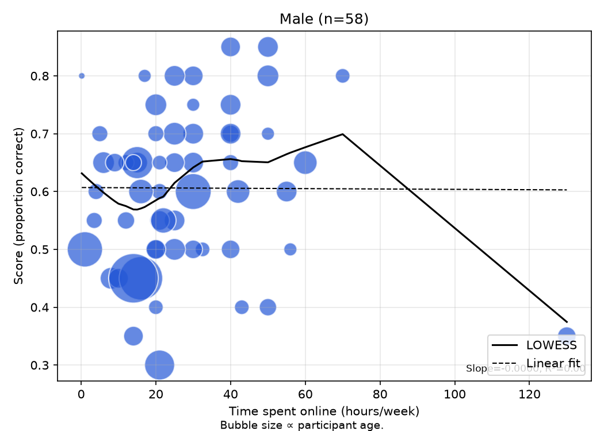
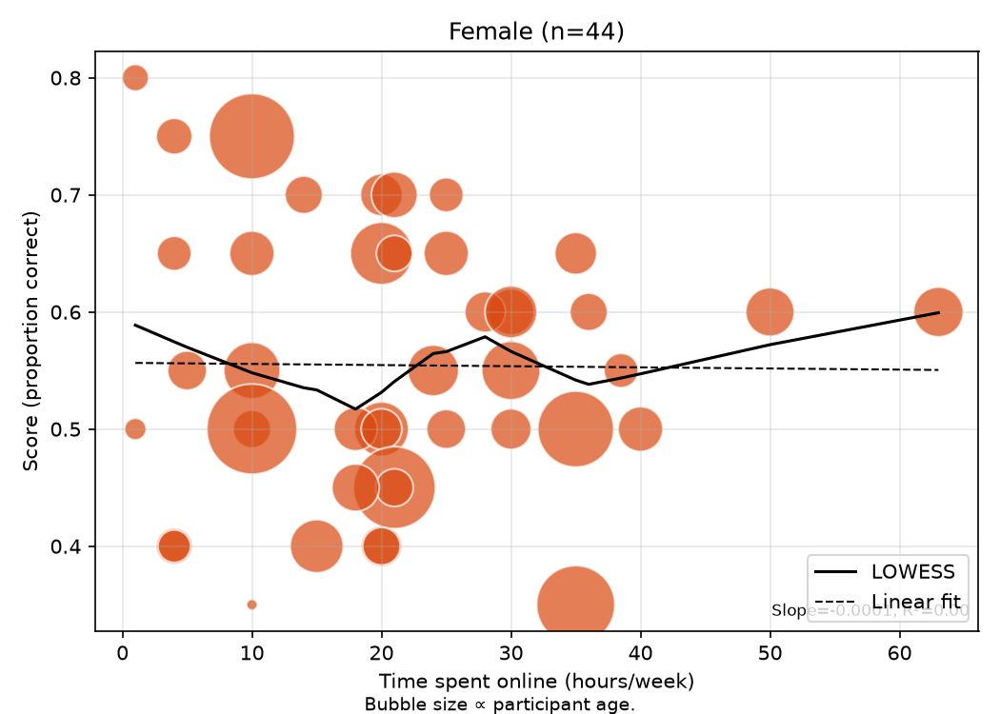

# Does time online affect spotting AI images?

DS Final Project. 102 people (58 men, 44 women) judged 20 images as AI-generated or human-made and reported how many hours a week they spend online. We tested whether internet exposure predicts their accuracy.

**Results site:** https://ds-2-dev.github.io/DS_FinalProject/

## Findings

### Overall (n = 102)

- **Time online makes no difference.** Pearson r = 0.03 (p = 0.76). In the main regression, +10 hours a week changes the score by −0.1 points (95% CI −2.7 to +2.5, p = 0.95).
- The result holds under every robustness check: dropping the 130-hour answer, using log(hours), dropping the imputed row, and removing the controls (`outputs/analysis/robustness.csv`).
- **People are only modestly better than chance.** Average accuracy was 58%; guessing gives 50%.

### Men vs. women

|                                  | Men (n = 58)          | Women (n = 44)        |
|----------------------------------|-----------------------|-----------------------|
| Average score                    | **60.6%**             | **55.5%**             |
| Scored above chance              | 69%                   | 55%                   |
| Median hours online / week       | 23.5                  | 20                    |
| Median age                       | 21                    | 20                    |
| Correlation, hours vs score      | 0.00 (p = 0.97)       | −0.01 (p = 0.94)      |
| Effect of +10 h/week (points)    | −0.3 (CI −3.9 to +3.3) | 0.0 (CI −2.7 to +2.6) |
| Effect of age (points per year)  | −0.39 (p = 0.001)\*   | −0.06 (p = 0.74)      |

- **Men scored 5.1 points higher than women.** Welch t-test p = 0.040, Mann–Whitney p = 0.044, Cohen's d = 0.41 (small to medium). This is the one clear group difference in the data.
- **Time online doesn't matter within either gender.** Both correlations are about zero.
- \***Age among men** looks significant, but it comes from 4 men over 40. Refit on men 40 or younger, the effect disappears (p = 0.47), and the rank correlation is not significant (p = 0.34). Treat it as a hint, not a finding.

| Men | Women |
|-----|-------|
|  |  |

### Classifiers (exploratory)

- A logistic model that flags low scorers (score ≤ 60%) from hours, age and gender reaches a cross-validated ROC AUC of 0.63, barely above chance.
- Per age × gender models (groups with n ≥ 6) do no better.

### Caveats

- Self-reported hours and a convenience sample, mostly ages 16–25.
- Observational data: these are associations, not causes.
- One hours answer was imputed with the median.
- There is no correction for multiple comparisons.

## Repository layout

```
data/
  raw/survey_responses.csv   Google Forms export (input)
  cleaned_dataset.csv        cleaned, anonymized data (generated)
src/
  run_all.py                 runs the whole pipeline below
  common.py                  shared paths, age bins, constants
  cleaning.py                parse raw CSV, hash names, impute missing hours
  analysis.py                regression, by-gender analysis, robustness -> outputs/analysis/
  plotting.py                overall EDA figures -> outputs/plots/
  subgroup_analysis.py       per-gender and per-age×gender plots -> outputs/plots/
  modeling.py                overall classifier -> models/, outputs/models/
  subgroup_modeling.py       per-subgroup classifiers -> models/subgroups/
  plot_models.py             ROC / PR / confusion / coefficient plots
  build_site.py              exports results to docs/data.json
notebooks/
  01_data.ipynb              the survey, cleaning, distributions
  02_analysis.ipynb          main question, men vs women, robustness, conclusion
  03_subgroups.ipynb         classifiers and subgroup plots
docs/                        GitHub Pages site (index.html + data.json)
```

`outputs/` and `models/` are generated. The notebooks only read pipeline outputs, and are committed without outputs.

## Reproduce

Requires Python 3.12.

```bash
python3.12 -m venv .venv
source .venv/bin/activate
pip install -r requirements.txt
python src/run_all.py
```

## Method notes

- **Cleaning:** names are replaced by a 12-character SHA-256 hash. Hours are parsed from free text (ranges are averaged, per-day answers are multiplied by 7, minutes are converted to hours). One unparseable hours answer is imputed with the median (21 h).
- **Main model:** `score_pct ~ time_spent_hours + C(gender) + age`, OLS with HC3 robust standard errors. Within each gender: `score_pct ~ time_spent_hours + age`.
- **Classifiers:** label = low performance (`score_pct <= 0.6`). Evaluated with stratified cross-validation; subgroups need n ≥ 6 and at least 2 of each class.

## Website

`docs/index.html` is a static black-and-white page that reads `docs/data.json`. It is served by GitHub Pages: **Settings → Pages**, branch `main`, folder `/docs`. The font is ABC Areal when it is installed on the viewer's machine; otherwise the page falls back to Arial. To preview it locally: `cd docs && python -m http.server`.
